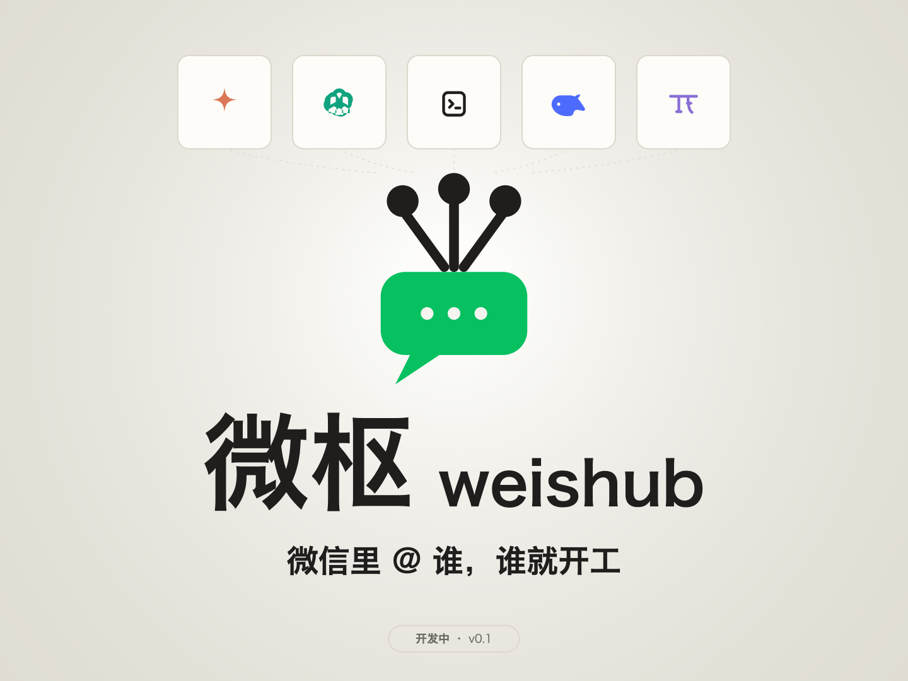

#  微枢 weishub

[](https://www.npmjs.com/package/weishub)
[](LICENSE)



在微信里指挥本机的 AI agent：手机发一条消息，claude / codex 等 CLI agent 在你的电脑上干活，结果直接回到微信对话框。

> 状态：**实验阶段**（配置接口可能变动）。零运行时依赖，安装即用。

## 它能做什么

- **微信就是终端**：给机器人发「跑一下测试并总结失败原因」，任务在你电脑的工作目录里执行，回复回到微信，支持断点续投（网络断了不丢回复）；
- **多 agent 并行**：`@codex 重构这个模块` 与默认 agent 同时干活，互不排队；`/agent` 切换默认，`/sessions` 绑定历史会话接着聊；内置支持 claude / codex / dsh / opencode / pi，装了哪个用哪个；
- **权限审批在微信完成**：claude 需要更高权限时，微信收到审批请求，回复「同意」或「拒绝」即可（真机端到端已验证）；也可以打开本机 Web 面板处理；
- **agent 主动找你**：agent（或任何本机脚本）用 `wx send "构建通过"` 把消息、图片推到你的微信，任务跑完不用盯着屏幕。

## 快速开始

### 前置要求

- Node.js ≥ 20
- macOS 或 Linux（Windows 尽力而为，未做一等公民测试）
- 本机已安装要用的 agent CLI（如 `claude`），启动时自动扫描 PATH 发现

### 安装

```bash
npm install -g weishub
```

想跟源码走（或参与开发）则从源码构建：

```bash
git clone https://github.com/Carl-5535/weishub.git && cd weishub
npm install && npm run build
npm install -g ./packages/weishub
```

注意：源码这种方式是 workspace 链接式安装，全局 `weishub` 命令指向本仓库目录——安装后不要移动/删除仓库；更新时在仓库里重新 build + install 即可。

### 启动

```bash
weishub
```

预期输出（首次启动）：

```
尚未登录微信：请用手机微信扫码（先打开下方面板地址完成扫码登录）
扫码面板：http://127.0.0.1:8090/?token=…
```

浏览器会自动打开面板，用手机微信扫码确认，之后看到：

```
扫码成功，正在启动微枢…
微枢已启动。面板地址：http://127.0.0.1:8090/?token=…
```

### 验证

微信里给机器人发「你好」→ 收到绑定成功欢迎语和 agent 回复，即跑通。

再验证主动推送（另开终端）：

```bash
wx status
# 预期输出：
# 微信登录：已登录
# 发件箱待发：0 条

wx send "来自终端的消息"
```

`wx` 的连接配置由 `weishub` 启动时自动写入 `~/.weishub/`，无需手工配置。

### 故障排查

| 问题 | 原因 | 解决 |
| --- | --- | --- |
| 启动报「另一个 weishub 实例正在运行 (pid=…)」 | 已有实例在跑 | 停掉旧实例；若确认没有，删除 `~/.weishub/hub.lock` |
| `wx` 报「未找到 hub 令牌」 | `weishub` 没在运行 | 先启动 `weishub` |
| `wx` 报 HTTP 401 | 全局安装的是旧版 | `npm install -g weishub@latest` 更新；源码安装则在仓库重新 `npm run build && npm install -g ./packages/weishub` 后重启 |
| 启动时警告「检测到旧微信插件仍在活动」 | 旧 dsh-wechat-gateway 在抢同一长轮询通道 | 先停掉旧插件，见[迁移说明](docs/migration-dsh.md) |
| `wx send` 报「微信通道未就绪」 | 凭据过期（约 24 小时），或重新扫码后机器人尚未获得会话权 | 手机上给机器人发条消息即自动续期/激活；内容会保留在发件箱，通道恢复后自动补发 |
| 发消息没反应，`wx send` 一直「微信通道未就绪」 | 绑定在服务端卡死（出站假成功、入站不投递） | 备份并删除 `~/.weishub/account.json` 后重启 `weishub` 重新扫码（避免服务端把扫码重定向回旧绑定） |
| 扫码后要求数字验证码 / 一直「登录超时」 | 服务端风控或网络异常 | 看终端报错重试；持续失败检查代理/网络 |

## 下一步

- 把回复里的文件发给微信、切换工作目录、调整 agent 超时 → [配置参考](docs/config.md)
- 用 Claude Code skill 让 agent 自动汇报 → `packages/skills/weishub-notify`（软链到 `~/.claude/skills/` 即可）
- 从 dsh-wechat-gateway 迁移 → [迁移说明](docs/migration-dsh.md)
- 组件与投递语义 → [架构](docs/architecture.md)

## 已知限制

- **codex 审批桥未实现**：codex 的 `approval: "app-server"` 只是占位配置，auto 模式下按 flags 执行，不会经微信询问（claude 桥不受影响）；
- **agent 输出解析样本有限**：内置配置按 codex 0.163.0、opencode v2.0.32、pi v0.73.1 实测校准（见 `packages/core/src/builtin-agents.json` 内注释），其他版本遇到解析偏差请附原始输出样本反馈；
- 重新扫码绑定后，需手机先给机器人发一条消息，主动推送（`wx send`）才可用；期间推送内容保留在发件箱不丢失；
- 凭据约 24 小时有效，收信自动续期；过期后收信不受影响，仅 `wx send` 不可用。

## 反馈与贡献

- **Bug / 建议**：[提交 issue](https://github.com/Carl-5535/weishub/issues/new)——附上 `weishub` 终端输出与复现步骤；涉及解析问题的请附 agent 原始输出样本
- **欢迎提 PR**：修 bug、补文档、新增 agent 内置配置都很适合；动手前建议先开个 issue 对齐方向
- **安全问题**（凭据泄露、权限绕过等）：**请不要开公开 issue**，[发邮件](mailto:2213337499@qq.com)私下报告
- 参与开发（环境搭建、测试、提交流程）见 [CONTRIBUTING.md](CONTRIBUTING.md)
